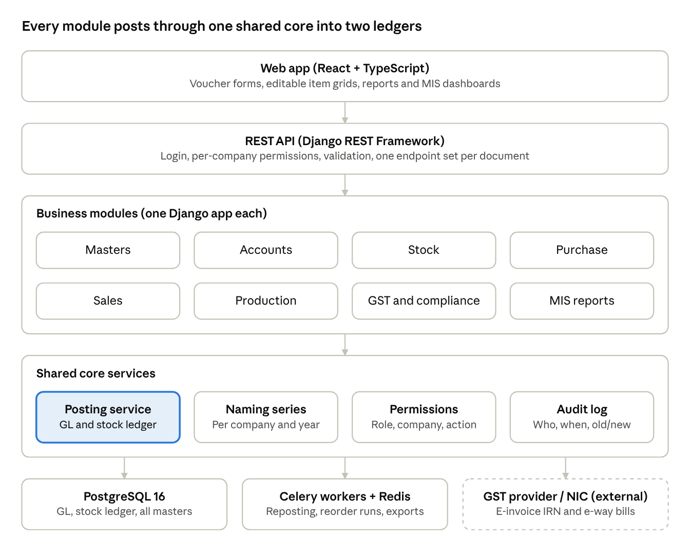
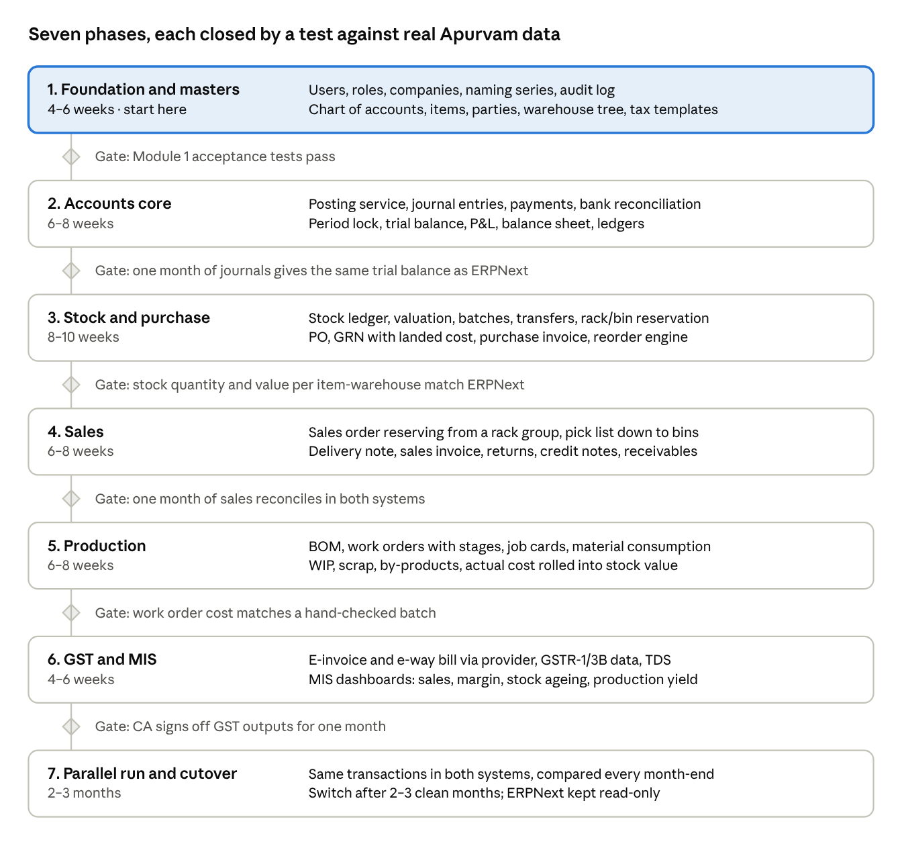

# MyERP — Architecture & Module 1 Spec

Nov 2, 2026 · @Sidharth

## Goals and scope

Build an independent, web-based ERP that runs Apurvam's books, stock, production, purchase and sales end to end, written with Claude and owned fully by Apurvam.

Target outcomes for v1:

- **Correct books first.** Every transaction posts balanced double-entry GL and stock ledger entries that match what a CA would expect.

- **Fix today's ERPNext pain points by design.** Sales Orders allocate from a rack/bin warehouse group, reordering is driven by real min/max and lead times, and work orders track every stage and consumption.

- **Multi-company from day one.** Apurvam Organics LLP and Apurva Organics Ltd as separate legal entities with separate GSTINs, books and numbering, on one install.

- **Indian compliance.** GST (CGST/SGST/IGST, RCM), HSN, e-invoice and e-way bill data, TDS/TCS, GSTR-1/3B extracts.

In scope for v1: masters, accounts, inventory, purchase, sales, production, GST, MIS dashboards. Out of scope until later: payroll/HR, CRM pipeline, e-commerce sync, mobile app.

## Tech stack

Recommended: Python/Django on PostgreSQL with a React front end. It is mature, boring and well known to Claude, and it keeps you in Python, which you already read from Frappe work.

| Layer           | Choice                                                                  | Why                                                                         |
|-----------------|-------------------------------------------------------------------------|-----------------------------------------------------------------------------|
| Database        | PostgreSQL 16                                                           | Real transactions, row locks, NUMERIC types for money, strong reporting SQL |
| Backend         | Django 5 + Django REST Framework                                        | ORM, migrations, auth, admin screens for free; huge ecosystem               |
| Background jobs | Celery + Redis                                                          | Reposting, e-invoice calls, scheduled reorder runs, report exports          |
| Front end       | React + TypeScript (Vite), TanStack Query, a data-grid library          | Fast forms and editable grids for item tables on vouchers                   |
| PDFs            | WeasyPrint (HTML/CSS to PDF)                                            | Modern CSS, unlike wkhtmltopdf                                              |
| Reports / MIS   | SQL views + Django endpoints; Metabase later if needed                  | Keeps MIS on the same database, no sync                                     |
| Tests           | pytest + factory_boy                                                    | Every posting rule gets an automated test                                   |
| Deploy          | Docker Compose on a VPS in Mumbai region (AWS Lightsail / DigitalOcean) | One command to deploy; nightly DB backups to object storage                 |
| Code            | Private GitHub repo, GitHub Actions CI                                  | Claude works from the repo each session; tests run on every push            |

Alternative if you prefer JavaScript end to end: NestJS + Prisma + PostgreSQL. Same architecture, less built-in admin.

## System architecture

A layered monolith: one codebase, one database, modules as separate Django apps that all post through a single shared core.

system architecture · 5 layers

The React app talks only to the API. Every module calls the shared posting service, which writes the two ledgers in PostgreSQL; slow work like reposting and reorder runs goes to background workers.

Repo layout:

myerp/  
backend/  
core/ \# company, users, permissions, naming, audit, posting service  
masters/ \# items, parties, warehouses, UOM, price lists  
accounts/ \# GL, journals, payments, period close  
stock/ \# stock ledger, receipts, transfers, reservations, reorder  
buying/ \# PO, GRN, purchase invoice  
selling/ \# SO, pick list, delivery, sales invoice  
manufacturing/ \# BOM, work orders, job cards  
gst/ \# tax calculation, e-invoice, returns data  
reports/ \# MIS endpoints  
frontend/ \# React + TypeScript  
docs/specs/ \# one spec per module  
deploy/ \# Docker Compose, backup scripts

## Core design rules

These rules are fixed before any module is written; every later module must obey them.

1.  **Two ledgers are the source of truth.** The GL entry table (accounts) and the stock ledger entry table (inventory). Every report, balance and valuation is derived from them; no balance is stored that can't be rebuilt.

2.  **Posted entries are immutable.** A submitted document is never edited. Corrections happen by cancel (which posts exact reversal entries) and amend (a new version). Every change carries user and timestamp.

3.  **Document lifecycle:** Draft → Submitted → Cancelled, with optional approval states between Draft and Submitted. Only Submitted documents touch ledgers.

4.  **Every GL posting balances.** Debits equal credits per voucher, per company, enforced in one shared posting service and by a database check, not by each module.

5.  **Precision:** money as NUMERIC(18,2), rates and quantities as NUMERIC(18,6), exchange rates NUMERIC(18,9). Never floats. Rounding happens in one place, with a round-off account.

6.  **Multi-company on every row.** Every transaction and ledger row carries company_id; all queries filter by it. Inter-company sales post mirror documents in both books.

7.  **Fiscal periods can be locked.** Once a month is closed, nothing posts into it without an explicit reopen by an authorised role.

8.  **Stock valuation per item-warehouse:** FIFO for all items by default. Each item-warehouse keeps a queue of incoming lots (qty, rate, date); issues consume the oldest lots first, and transfers carry the lot rates to the new warehouse. Backdated entries trigger a background repost of later entries for that item, rebuilding the FIFO queue.

9.  **Warehouses are a tree with real allocation.** Orders can reserve against a parent (e.g. a rack group); picking resolves to leaf bins. This is the fix for the ERPNext group-warehouse limitation.

10. **One posting service, many documents.** Purchase invoice, sales invoice, stock entry and payment all call the same tested functions to create ledger rows.

## Module roadmap

Roughly 10–13 months of part-time build, then 2–3 months of parallel running before ERPNext is switched off.

build roadmap · 7 phases, 6 gates

Durations are estimates for one person working with Claude a few hours a day; a phase starts only when the gate above it passes.

## Module 1 spec: Foundation and masters

Module 1 delivers login, roles, companies and every master record the transaction modules need; no ledger postings yet. Estimated 4–6 weeks of evening/part-time sessions.

### Platform pieces

- Users, roles and permissions per company (read / create / submit / cancel per document type)

- Audit log on every master change: who, when, old value, new value

- Naming series per company and document type (e.g. AOL/PO/2026-27/0001), fiscal-year aware

- Base document model: status, company, created/modified by, version, docstatus

### UI building blocks

Built once in Module 1 and reused by every later screen, so all forms and reports behave the same way.

**Link field (autocomplete dropdown)**

- Search-as-you-type on code and name, with secondary info in each row (e.g. item code · name · HSN; party · GSTIN · city)

- One generic search endpoint per master, respecting company permissions

- Context filters set by the form: only suppliers on a PO, only leaf bins under the chosen rack, only active items

- Recently used values shown first; "create new" opens a quick-entry form without leaving the screen

- Fetch-on-select: choosing an item fills UOM, rate, GST template and default warehouse

- Full keyboard use inside editable item grids (type, arrow, Enter, Tab to next cell)

**Report framework**

- Each report = a query + a short filter definition; the screen is generated from it

- Filter bar: date range, company, warehouse, item group, party and any report-specific filters, with sensible defaults

- Data grid: sort, column filters, show/hide and reorder columns, group with subtotals, pinned columns, totals row

- Saved views per user (filters + columns + grouping), optionally shared with a role

- Drill-down: trial balance figure → ledger entries → the voucher itself

- Export to Excel, CSV and PDF

- Charts **(added 8 Nov)**: pie, line and bar from any report's result, switchable on screen, saved with the view, printed and exported with it; used by MIS dashboards and the AI assistant (see [05-ai-assistant.md](05-ai-assistant.md))

### Masters

| Master               | Key fields                                                                                                                                                       | Rules                                                               |
|----------------------|------------------------------------------------------------------------------------------------------------------------------------------------------------------|---------------------------------------------------------------------|
| Company              | Legal name, GSTIN, PAN, state, address, base currency INR, fiscal year start                                                                                     | GSTIN format and state code validated; at least one per install     |
| Fiscal year / period | Year, start/end, monthly periods, locked flag                                                                                                                    | Periods can't overlap; lock blocks posting                          |
| Chart of accounts    | Tree: group/ledger, root type (asset, liability, equity, income, expense), company, account type (bank, receivable, payable, stock, tax, round-off)              | Only ledger (leaf) accounts accept postings; seeded Indian template |
| Cost centre          | Tree per company                                                                                                                                                 | Optional on postings in v1                                          |
| Tax templates        | GST rates 0/5/12/18/28, CGST+SGST vs IGST accounts, RCM flag, TDS sections                                                                                       | Intra/inter-state chosen from company state vs place of supply      |
| UOM + conversions    | Unit, conversion factor per item (kg, g, packet, carton, pallet)                                                                                                 | Stock always held in item's stock UOM                               |
| Item group           | Tree                                                                                                                                                             | Default accounts and tax template inherit down the tree             |
| Item                 | Code, name, group, stock UOM, HSN, GST template, valuation method, batch tracked, shelf life, min/max/reorder qty, lead time days, default warehouse per company | Reorder fields drive the Module 3 reorder engine                    |
| Warehouse            | Tree per company: site → zone → rack → bin; group flag, allocatable flag                                                                                         | Only leaves hold stock; groups can be reserved against              |
| Customer / Supplier  | Name, GSTIN, PAN, state, addresses, contacts, credit limit, payment terms, default price list, TDS section                                                       | GSTIN ↔ state consistency check                                     |
| Price list           | Buying/selling, currency, item rates with validity dates                                                                                                         | One active rate per item per date                                   |
| Payment terms        | Template of due-date splits                                                                                                                                      | Used by invoices in Module 2+                                       |

### Acceptance tests (must pass before Module 2 starts)

- [ ] Two companies created; a user with rights only in one company sees nothing of the other

- [ ] Indian chart of accounts seeded; posting to a group account is rejected

- [ ] A GSTIN whose state code doesn't match the party state is rejected

- [ ] Naming series restarts at 0001 in a new fiscal year

- [ ] Warehouse tree of site → rack → bin builds; marking a group as a stock-holding leaf is rejected

- [ ] Item import from an ERPNext export CSV works for 500+ items

- [ ] Every master edit appears in the audit log with old and new values

<!-- -->

- [ ] Typing part of an item name in a link field returns matches in under 300 ms on 5,000+ items

- [ ] A bin link field filtered to one rack shows only that rack's leaf bins

- [ ] An item master report with company and item group filters is built from a definition alone, and exports to Excel

- [ ] A user's saved view reloads with the same filters, columns and grouping

## How we work

The repo, not chat history, is the project's memory: every session starts from the code, specs and tests in GitHub.

1.  **Repo setup.** Private GitHub repo with docs/specs/ (one markdown spec per module), docs/decisions/ (short notes on choices like valuation method), and the code. Claude reads these at the start of each session.

2.  **Spec before code.** For each module, we write the spec together (entities, fields, posting rules, edge cases). You sign off on posting rules with your CA where accounting is involved.

3.  **Small slices.** Each session delivers one testable slice, e.g. "Item master + import" or "Purchase receipt posting". Claude writes code and tests, opens a pull request, CI runs the tests.

4.  **You test with real cases.** Feed real Apurvam scenarios: a GRN with freight, a partial delivery, a batch expiring. Every bug becomes a new automated test before it's fixed.

5.  **Staging then production.** A staging server gets every merge; production updates only after you've clicked through.

6.  **Parallel run.** From Module 3 onward, enter the same month's transactions in both ERPNext and the new system and compare trial balance and stock balance. Switch only after 2–3 clean months.

Best tool for this: Claude Code (agentic coding, works directly in the repo). This chat can also attach the GitHub repo once it exists.

## Open decisions

- [ ] Confirm stack: Django + React (recommended) or NestJS + React

- [ ] Default stock valuation: decided — FIFO for all items

- [ ] Hosting: VPS you manage, or a managed platform (Render / Railway / AWS) at higher cost

- [ ] Will production, purchase or sales users need mobile/tablet screens in v1?

- [ ] E-invoice and e-way bill: direct NIC API or via a GSP (GST Suvidha Provider)

- [ ] Who validates posting rules: you alone, or with your CA per module

- [ ] Budget for running costs (server, backups, GSP fees)
