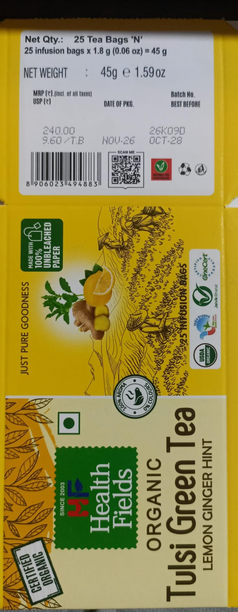

# Batch code print check from a photo (spec, 10 Nov 2026)

Requested by Sidharth: "In case I have the batch coding details fed in the manufacturing order, can the system check and verify with the actual print photo?"

Status: spec only, for review. Nothing is built until Sidharth approves it. It needs batches (Phase 3a) and work orders (Phase 5), so it is built with Production. The same check serves the "batch code print check" on receipt already planned in the quality add-on (spec 05, Receive).

## The answer in one line

Yes. The work order holds what the pack **should** say (batch no, MRP, USP, date of packing, best before). On the line, a person takes a phone photo of the coded pack. An AI vision model **reads** the printed text, MyERP's own code **compares** it field by field with the work order, and the person sees a green or red result next to the photo. The person presses "Pass" or "Fail"; the photo and both sets of values are kept as the quality record of that batch.

## Tried on a real carton

The photo Sidharth sent (Health Fields Organic Tulsi Green Tea, 25 tea bags) was read field by field:

| Field on the pack | Read from the photo | How MyERP would know the expected value |
| --- | --- | --- |
| MRP (₹) (incl. of all taxes) | 240.00 | Item's dated MRP master |
| USP (₹) | 9.60 / T.B | MRP ÷ units in the pack: 240.00 ÷ 25 tea bags = 9.60 (checked: matches) |
| Date of pkg. | NOV-26 | Work order's packing date, printed as MMM-YY |
| Batch No. | 26K09D | Work order's batch (see the pattern below) |
| Best before | OCT-28 | Packing date + item shelf life |
| Barcode | 8906023494883 | Item's GTIN (EAN-13) from the item UOM table; read by the phone's barcode reader, not by AI |

All five printed fields and the barcode were readable from an ordinary phone photo, even though the coding is small dot print on a white panel. So the idea works on Apurvam's real packs. Two things the photo also suggests, to be confirmed (open questions 1 and 2):

- **26K09D** looks like year 26, month K (the 11th letter, so November), day 09, and D (line or shift). That agrees with "NOV-26". If that is the rule, MyERP can **make** the batch number on the work order from the date, and the check also catches a coder that still has yesterday's date.
- **OCT-28** is 23 months after NOV-26, so best before seems to be "packing month + 24 months − 1", that is, best before the end of the month before. That becomes an item setting (shelf life in months and how it is printed), not code.

## Where the expected values come from

On the work order, a **"Batch coding"** section, filled when the order is released and locked once the first check passes:

| Field | Source | Can a person change it? |
| --- | --- | --- |
| Batch no | Made from the item's batch pattern and the packing date (or typed, if the item has no pattern) | Yes, before the first check |
| Date of packing | The work order's planned date, editable | Yes |
| Best before / expiry / use by | Packing date + the item's shelf life, rounded the way the item says | No, change the item or the date |
| MRP | Item's MRP on the packing date (dated master data, rule: rates are never constants) | No, change the MRP master |
| USP | MRP ÷ the pack's unit count (from the item UOM table), with the unit text ("T.B", "g", "ml") from the item | No |
| Other print lines | Optional extra lines in the item's **print layout** (for example "Lot", plant code, shift) | Yes |

The item's **print layout** is master data: which fields appear on which pack (pouch, carton, shipper/CFC), in what format ("NOV-26", "11/2026", "₹240.00"), and in what order. Different packs of the same work order can have different layouts, and each is checked on its own. The same values become the **coder message**, the text the line operator keys into the inkjet or thermal printer, shown on the work order and on the phone so it is typed from one source.

## The check on the line

In the mobile app's Production workspace (spec 05: one app, role workspaces):

1. **Open the work order**: scan its QR code from the job card, or pick it from today's list. The expected print appears at the top.
2. **Take a photo** of the coded pack. The screen shows a frame to fit the coding panel in, and warns about glare or blur before sending.
3. **Read**: the photo goes to the server. The barcode is decoded by an ordinary barcode library (exact, no AI). The vision model is asked only to read the printed text and return each labelled field with its text and how sure it is. It never sees the expected values, so it cannot "agree" with them.
4. **Compare** (MyERP code, not AI): each field is compared after simple tidying (spaces, case, "₹", trailing ".00"). Letters and digits are not swapped (no "O means 0"), because batch codes mix both; a doubtful character is shown as doubtful.
5. **Result**, one row per field: expected | read | ✓ / ✗ / "could not read", with the photo beside it, zoomable. Overall: **All match**, **Mismatch**, or **Not readable**.
6. **The person decides**: "Pass" or "Fail" with a remark (decision 0006, AI only suggests). A "Pass" over a mismatch needs a reason and a role allowed to override (a QC person or above), and is shown in the record as an override. "Not readable" offers "Retake" or "Enter by hand" (the person types what they see; it is then compared the same way and marked as entered by hand).

### When the check is done

Set per item (or per company default), as master data:

- **First-off**: before the run starts; the batch cannot be produced into stock until the first-off check is passed.
- **During the run**: every N hours, at each shift change, and whenever the coder is restarted or its message changed. The phone reminds the line when a check is due.
- **Last-off**: at the end of the run.
- Optional **at dispatch** and **on receipt** (bought-in finished goods or co-packed goods), with the same screen against the PO/GRN batch instead of the work order.

### When it fails

- The batch's QC status stays or goes back to **quarantine** (design rule 12), so it cannot be picked.
- An alert goes to the production supervisor and QC (in-app and email; WhatsApp later with notifications).
- The quantity made **since the last passed check** is marked "to recheck", so the team knows exactly which cartons to pull and recode.
- Releasing the batch later needs a new passed check.

## What is kept

A **print check record** for every photo: work order, batch, item, pack type, check type (first-off, in-run, last-off, receipt, dispatch), the photo, expected values, values read with confidence, result, the person's decision and remark, who, when, device. Records cannot be edited; a mistake is corrected by a new check. They show:

- on the batch (part of batch traceability: "which checks did this batch pass, with photos"),
- on the work order,
- in a **Print check register** report (by date, line, item, result), useful as FSSC 22000 / ISO evidence and for Legal Metrology inspections.

Photos are stored in the tenant's file storage (Cloud Storage, Mumbai), resized to keep the size small, kept for the batch's shelf life plus a set period (company setting, default 1 year after best before).

## Legal Metrology helper

Since MyERP knows the pack, it can also flag a **missing declaration**: a pack layout for a retail pack that has no MRP, no USP, no date of packing or manufacture, or no best before / use by. This is a warning on the item's print layout when it is set up, not a check on each photo.

## Cost, switches and SaaS

- Part of the **quality add-on**, switched on per company (decision 0014) and a plan feature for SaaS.
- The AI reading counts against the tenant's monthly AI spend cap (decision 0006 and the AI assistant spec). One photo is one short call, a small fraction of a rupee to about a rupee depending on the model. When the cap is reached, the check still works with "Enter by hand".
- AI only reads; it never sets a QC status or releases a batch.
- No tenant-specific code: patterns, layouts, frequencies and who can override are all data.

## Later

- **Send the message to the coder directly.** Many industrial inkjet and thermal coders accept their message over the network. MyERP could send the work order's coder message to the printer, so nothing is keyed by hand and the most common mistake (an old date or batch left on the coder) cannot happen. Depends on the coder make and model (open question 3).
- **Fixed camera on the line** reading every pack and counting rejects, instead of a phone at intervals. A separate project, only if the photo checks show it is needed.

## Build order (one PR each, each after the previous is seen)

1. Item settings: batch pattern, shelf life and its rounding, pack print layouts (with Items / batches, Phase 3a).
2. Work order "Batch coding" section and coder message (with work orders, Phase 5).
3. Print check on a desktop screen: upload a photo, read, compare, Pass/Fail, record, register report.
4. The same check in the mobile app's Production workspace, with due-check reminders and fail alerts.
5. Print check on receipt and at dispatch, against GRN / delivery note batches.

## Open questions for Sidharth

1. **Batch pattern**: does 26K09D mean year 26, month K = November, day 09, and D = line or shift? Is it the same for every product and plant?
2. **Best before**: is it always packing month + shelf life − 1 month (NOV-26 → OCT-28 for 24 months)? Is shelf life fixed per item?
3. **Coders**: what printers code the packs (make, model, inkjet or thermal), and how many lines? This decides whether sending the message to the coder is possible.
4. **Which packs**: check the carton only, or also the inner pouch/sachet and the shipper (CFC)?
5. **How often**: first-off and last-off only, or also every few hours / every shift?
6. **On fail**: should the line stop until a new check passes, or only the batch go into quarantine?
7. **MRP**: is MRP the same everywhere for an item, or does it differ by channel or region (which would put more than one MRP on one work order)?
